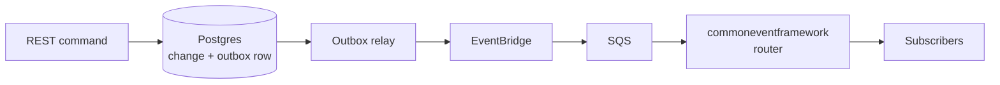

# Tours App

Vacation management app: requesters submit vacation requests, validators approve or reject them. See [ASSIGNMENT.md](ASSIGNMENT.md) for the brief.

## Stack

| Layer     | Tech                                                                         |
| --------- | ---------------------------------------------------------------------------- |
| Backend   | NestJS, TypeScript, TypeORM, JWT, `commoneventframework`                     |
| Events    | Transactional outbox in Postgres → EventBridge → SQS (LocalStack, no AWS account needed) |
| Frontend  | Vue 3, Vue Router, Axios, CSS Modules, Vite                                  |
| Database  | PostgreSQL 16, SQL scripts in `db/init/`                                     |
| Runtime   | Docker Compose, nginx (serves the frontend, proxies `/api`)                  |
| Tests     | Jest (backend), Vitest (frontend), Playwright (e2e)                          |

## Technical decisions

- **CSS Modules** for styling: while it is not a framework, it is native, needs no extra syntax or dependencies, only the bundler configuration, and keeps the code clean.
- **NestJS** for the backend: robust, typed and guarded, with dependency injection, so it stays clean and scales easily.
- **Docker with mocked AWS:** everything runs inside Docker for ease of use, with LocalStack standing in for the AWS services.
- **Event pipeline with our own events:** the assignment specifies none, so we defined a set of vacation-request and login events.
- **Prettier and ESLint** keep the code style consistent and the files clean, including for LLM-assisted changes.
- **Test suites** (unit and e2e) catch unexpected breakage when code is changed, by a person or an LLM.
- **Database seed scripts** run automatically, so there is dummy data to test with right away.
- **Simple, minimal UI:** the focus is on the logic and the implementation itself.
- **End date must be after start date**, as the brief says, enforced in the API and in the schema. Overlap checks include both end dates.
- **"Past" means before today (UTC);** starting today is allowed.
- **Approved and rejected requests are final.** Only pending requests can be edited or cancelled; a rejected request is replaced by a new one.
- **Decisions are atomic** (`UPDATE ... WHERE status = 'Pending'`), so two validators cannot both decide a request.
- **Role separation:** validators don't submit requests; requesters can't see others' requests (404, not 403, to avoid leaking existence).
- **Team calendar shows approved vacations only**, never reasons or comments.
- **Transactional outbox** keeps database and events consistent without distributed transactions.
- **`commoneventframework` is used on the consuming side** (normalising and routing), since it does not publish; publishing uses the AWS SDK from the relay.

## Run

```bash
cp .env.example .env && cp backend/.env.example backend/.env
docker compose up --build
```

- App: http://localhost:8080
- API: http://localhost:3000/api
- Event pipeline check: http://localhost:8080/events-test (click **Send event**)

Without Docker for the apps: `docker compose up -d postgres localstack`, then `npm run start:dev` in `backend/` and `npm run dev` in `frontend/` (http://localhost:5173).

### Demo accounts

Seeded on first start. Password for all: `Password123!`

| Email                                           | Role      |
| ----------------------------------------------- | --------- |
| alice@, bob@, dave@, erin@`example.com`         | Requester |
| carol@, victor@`example.com`                    | Validator |

## Database

The schema is owned by SQL (`synchronize` is off). The scripts in `db/init/` run once, when the Postgres volume is first created (reset with `docker compose down -v`):

| Script           | Purpose                                                                                                                                       |
| ---------------- | --------------------------------------------------------------------------------------------------------------------------------------------- |
| `01-schema.sql`  | Tables (`users`, `vacation_requests`, `event_outbox`), enums, indexes, and constraints: valid date range, rejection comment, no overlapping requests per user, approved requests frozen |
| `02-seed.sql`    | Demo users and requests                                                                                                                       |
| `03-app-role.sh` | Limited database role the backend connects as (DML only)                                                                                      |

The API checks the same rules first to return friendly errors; the database enforces them under concurrency.

## Architecture



A command and its event are written in one database transaction (outbox pattern), so an event exists if and only if the change was committed. The relay publishes it to EventBridge, a rule forwards it to SQS, and the consumer routes it through `commoneventframework` to subscribers (requester notifications, dev log).

Backend modules (`backend/src`):

- `auth` – login, JWT guard, role guard (`@Roles()`), `@CurrentUser()`
- `users` – user entity and the validator's user filter
- `vacation-requests` – entity, DTOs, business rules, service, controllers, notifications
- `events` – event contract, outbox, relay, router, consumer
- `aws`, `localstack` – AWS client providers and local bus/queue provisioning
- `common` – pagination and shared validators

Frontend (`frontend/src`): `router/`, `views/`, `components/`, `store/`, `api/` (Axios modules).

## API

Prefix `/api`. Everything except login needs `Authorization: Bearer <token>`. Lists return `{ items, meta: { page, limit, total, totalPages } }` (`limit` default 10, max 100), newest first.

| Method & path                         | Role      | Purpose                                                  |
| ------------------------------------- | --------- | -------------------------------------------------------- |
| `POST /auth/login`                    | public    | `{ email, password }` → `{ accessToken, user }`          |
| `GET /auth/me`                        | any       | Current user                                             |
| `POST /vacation-requests`             | Requester | Submit `{ startDate, endDate, reason? }`                 |
| `GET /vacation-requests/me`           | Requester | Own requests, `?status&page&limit`                       |
| `PATCH /vacation-requests/:id`        | Requester | Edit own pending request                                 |
| `DELETE /vacation-requests/:id`       | Requester | Cancel own pending request                               |
| `GET /vacation-requests`              | Validator | All requests, `?status&userId&page&limit`                |
| `POST /vacation-requests/:id/approve` | Validator | Approve, optional `{ comment }`                          |
| `POST /vacation-requests/:id/reject`  | Validator | Reject, `{ comment }` required                           |
| `GET /vacation-requests/:id`          | any       | One request (requesters: own only)                       |
| `GET /team/vacations`                 | any       | Approved vacations in `?from&to`, no reasons             |
| `GET /users`                          | Validator | Users for the filter dropdown                            |

Errors: 400 validation, 401 unauthenticated, 403 wrong role, 404 not found (or not yours), 409 conflict (overlap, request already decided).

## Events

| Event type                          | Raised when                                      |
| ----------------------------------- | ------------------------------------------------ |
| `travel.vacation-request.submitted` | A request is submitted                           |
| `travel.vacation-request.updated`   | A pending request is edited                      |
| `travel.vacation-request.cancelled` | A pending request is cancelled                   |
| `travel.vacation-request.approved`  | A validator approves                             |
| `travel.vacation-request.rejected`  | A validator rejects                              |
| `travel.vacation-request.expired`   | A request is still pending after its start date  |
| `travel.auth.login-succeeded`       | Successful login                                 |
| `travel.auth.login-failed`          | Failed login                                     |

All events share one envelope (`eventId`, `type`, `occurredAt`, `correlationId`, `actor`, `data`), typed in `backend/src/events/event-types.ts`. Payloads carry ids and a small snapshot, never free text or credentials.

- **Reliable delivery:** the outbox relay claims rows with `FOR UPDATE SKIP LOCKED`, so a crash or bus outage never loses an event. Delivery is at-least-once; subscribers de-duplicate on `eventId`.
- **Routing:** `commoneventframework` routes each SQS message to `PUT /events/<type>`; modules join by calling `EventRouter.subscribe({ name, types, handle })`, so adding a consumer does not touch the pipeline.
- **Dev endpoints:** `/api/test/*` (behind `/events-test`) exists only when `ENABLE_TEST_ENDPOINTS=true`, which the example env sets.

## Configuration

Two files, both copied from their `.env.example`: the root `.env` (Docker Compose: ports, database credentials) and `backend/.env` (API settings: AWS endpoint, event bus/queue names, `JWT_SECRET`, `JWT_EXPIRES_IN_SECONDS`, `VACATION_EXPIRY_INTERVAL_SECONDS`, `OUTBOX_POLL_INTERVAL_MS`, `ENABLE_TEST_ENDPOINTS`). The defaults work as-is for local development.

## Testing

| Command (repo root) | What it runs                                         |
| ------------------- | ---------------------------------------------------- |
| `npm run test:unit` | Backend Jest and frontend Vitest suites              |
| `npm run test:e2e`  | Playwright against the real stack                    |
| `npm test`          | Both                                                 |

E2E setup:

```bash
docker compose up -d postgres localstack   # the API and Vite dev server are started by Playwright
docker compose stop app                    # if the full stack is running: it shares the outbox table
npx playwright install chromium            # first time only
npm run test:e2e
```

The specs are `*.api.spec.ts` (HTTP only) and `*.ui.spec.ts` (Chromium driving the real frontend). The UI specs use `dave@` and `erin@` so they never touch the lists the API specs read from `alice@` and `bob@`.

E2E starts its own backend (`:3100`) and Vite (`:5273`) with a dedicated event bus and queue, and cleans up its own data, so it can be re-run on the same database.
